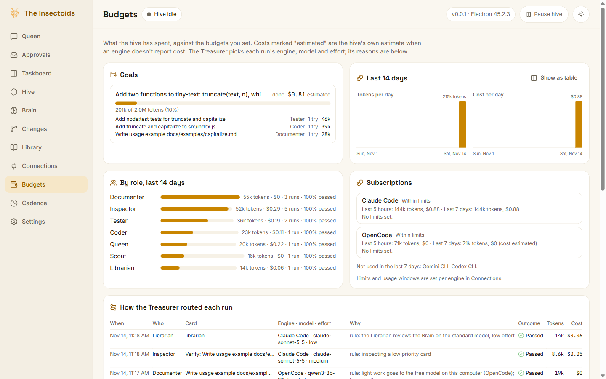

<p align="center">
  
</p>

<h1 align="center">The Insectoids</h1>

<p align="center">
  <strong>A local-first AI operating system, organised like a hive.</strong><br>
  You give the Queen a goal. Insect agents do the work in safe copies of your project.<br>
  An Inspector checks it. Nothing reaches your files without your approval, and everything can be undone.
</p>

<p align="center">
  <a href="https://github.com/Sanit-mann/The-Insectoids/releases/tag/v0.0.2">v0.0.2 · developer preview</a> ·
  <a href="LICENSE">MIT license</a> ·
  <a href="CONTRIBUTING.md">Contributing</a> ·
  <a href="functions/README.md">Design specs</a>
</p>

---


## What it is

The Insectoids is a desktop app that turns AI coding agents into an organised team you can trust with a real project.

- **The Queen** turns your goal into a plan of small task cards, grouped in waves. You approve the plan.
- **Insects** of eight castes (Coder, Tester, Reviewer, Documenter and more) pick up cards for their caste. Each one works in **its own git worktree**, a separate copy of your project, so they can work in parallel without touching your files.
- **The Inspector** checks every card against its "done means" list, with evidence such as tests run and diffs read, before the hive accepts it.
- **You approve the merge** into your branch. Undo is one click (with approval) and keeps the history; you can merge again later.
- **The Brain** is one local memory that every agent shares: decisions, tasks, facts and outcomes, with trust levels and version history. It lives in a SQLite file on your computer and is never uploaded.

It runs on the AI subscription you already have. **Claude Code** is the main engine; **OpenCode** can run a free model on your own computer (Ollama or LM Studio) or an API provider you add. Light work goes to the free model first, and a card that struggles moves up to a stronger one.

## Status: v0.0.2 (Phase 2 "The Full Hive")

This is an early developer preview, built and tested on Windows. v0.0.2 has no installer: you run it from source (see [Run it](#run-it)). Installers for Windows, macOS and Linux start with the next release (see [Install](#install)).

**What works today:**

- The full loop: goal → plan approval → parallel insects in worktrees → Inspector verification → merge approval → undo → merge again.
- **Eight insect castes** (coder, tester, reviewer, documenter, designer, researcher, writer, analyst) and the managers: Scout, Foreman, Librarian, Treasurer and Watchdog.
- **Two engines:** Claude Code, and OpenCode with a local model or an API provider. A first-run step installs either one, but only after you see the exact command and say yes.
- **A cost-aware router (the Treasurer):** it picks each run's engine, model and effort, says why in plain words, and learns from which runs pass.
- **The Vault and secret broker:** you type keys into the app once; agents call services through the broker and never see a key.
- **A library that learns:** skills switch on per card. Repeated successful work becomes a proposed skill you approve. Imported skills are safety-scanned first.
- **The Brain grows up:** local meaning search (a small model on your computer), ranking and fading, lessons from failures, a health score, a graph view and a dashboard, plus a code map of your project.
- **Screens:** Queen chat, Approvals, Taskboard, Hive (lanes and a living honeycomb), Brain, Changes & undo, Library, Connections, Budgets, and a full setup wizard with an optional sample goal.
- A command guard in front of every agent action (details under [Safety](#safety)), and a Watchdog that warns, pauses or stops an agent that keeps failing.

**Real end-to-end demo** (sample project `tiny-text`; goal: add `truncate` and `capitalize` with tests, then three usage example pages):

| | Result |
|---|---|
| Engines | Claude Code (Opus plans; Sonnet codes, tests and inspects) and OpenCode with qwen3:8b on this computer through Ollama |
| Plan | 2 waves, 5 cards, 3 castes |
| Free local model | the Scout and all three doc pages, each passing inspection on the first try |
| Learned skill | the three doc cards became a proposed skill, `write-function-usage-example-doc`; it scanned clean and was approved |
| Merge | 6 files into `main`; `node --test` passed on `main` |
| Meaning search | "shorten long strings" found the truncate work without sharing its words |
| Time and cost | 10 minutes; about 144k Claude tokens ($0.81 reported) plus 71k free local tokens |

It took three real runs: the first two did all the work but showed that the repeated-work check was too strict on real briefs, and then too loose about which skills already cover it. Both were fixed with tests. The full write-up is in [docs/plans/phase-2-full-hive.md](docs/plans/phase-2-full-hive.md).



**Tests:** 916 unit tests and 141 end-to-end tests (Playwright driving the real Electron app). A scripted engine runs every flow without spending tokens.

## What makes it different

Many projects run several AI agents. The Insectoids focuses on making their work **safe, checkable and reversible** on a real project.

| | The Insectoids |
|---|---|
| **Your files are never edited directly** | Every card runs in its own git worktree and branch. Only the hive commits, with the agent and card named on every commit. Your branch changes only when you approve a merge. |
| **Work is verified, not just reported** | A separate Inspector agent checks every card against its acceptance criteria. "Done" means it passed, not that an agent said so. |
| **Everything is undoable** | Undo a card, a whole goal, or the merge into your branch. History is kept, so you can merge again. |
| **A guard in front of every action** | Deleting outside the workspace, force-pushing, reading secrets, touching system settings: blocked, always. Pushing, publishing and new dependencies wait for your approval. |
| **One shared memory, built to save tokens** | Agents read a short boot card first, then search and read within a token budget, instead of re-reading everything each time. |
| **Memory you can trust** | Facts an agent writes start as *unconfirmed*; only you can confirm them. Nothing is deleted: changes become versions. Secrets are refused. |
| **Tool-agnostic doors** | Any MCP-capable AI tool can use the Brain; tools without MCP use the `brain` command. |
| **Local-first and private** | The Brain stays on your computer. No account, no telemetry, nothing uploaded. Agents never see your keys. |
| **You stay in charge** | One inbox for every decision, with "why it needs you" and "if you say yes" in plain words. Destructive approvals need a press-and-hold. |
| **Honest numbers** | The UI shows the model that actually ran and the effort the hive asked for, with real token counts and cost as reported by the engine. |

Compared with the projects that inspired it (credited below), it adds strict workspace isolation, independent verification, approvals and undo around the agents, and keeps it all in one desktop app with a shared, local memory.

## How it works

```
 You ──goal──▶ Queen ──plan (waves of cards)──▶ Approval inbox ──▶ Taskboard
                                                                       │
              ┌─────────────── insects pull cards for their caste ◀────┘
              ▼
   Coder / Tester ── each in its own git worktree, behind the command guard
              │
              ▼
          Inspector ── checks "done means" with evidence ──▶ hive branch
                                                                │
 You ◀── "Merge into main?" ◀───────────────────────────────────┘
          approve ─▶ merged   ·   undo ─▶ reverted   ·   merge again ─▶ re-applied

 The Brain (one local SQLite file, one writer) records every decision, task and outcome.
 Agents reach it through MCP or the `brain` command, with a token scoped to their project.
```


## Install

Installers are on the [Releases page](https://github.com/Sanit-mann/The-Insectoids/releases). Open the newest release and, under **Assets**, download the file for your computer:

| Your computer | File to download |
|---|---|
| Windows 10 or 11 (64-bit) | `The-Insectoids-Setup-<version>-x64.exe` |
| Mac with Apple silicon (M1 or newer) | `The-Insectoids-<version>-arm64.dmg` |
| Mac with an Intel chip | `The-Insectoids-<version>-x64.dmg` |
| Linux (64-bit), any distribution | `The-Insectoids-<version>-x86_64.AppImage` |
| Debian, Ubuntu and similar | `the-insectoids_<version>_amd64.deb` (or the AppImage) |

For real runs you still need **git** and **Claude Code** (signed in), as when running from source.

### Opening it the first time

The installers are **not signed yet**. Windows builds will be signed through the SignPath Foundation once it approves the project; macOS builds stay unsigned (there is no paid Apple account). So your computer warns you the first time. Check the file first (see [Check the download](#check-the-download)), then:

- **Windows:** run the `.exe`. If SmartScreen says "Windows protected your PC", click **More info**, then **Run anyway**. The installer asks where to install; it doesn't need admin rights.
- **macOS:** open the `.dmg` and drag The Insectoids into Applications. The first time, right-click (or Control-click) the app in Applications and choose **Open**, then **Open** again. If macOS only offers to move it to the Bin, close that message, open **System Settings → Privacy & Security**, scroll down and click **Open Anyway** next to The Insectoids. After that it opens normally.
- **Linux (AppImage):** make the file runnable, then start it:

  ```bash
  chmod +x The-Insectoids-<version>-x86_64.AppImage
  ./The-Insectoids-<version>-x86_64.AppImage
  ```

  If it says FUSE is missing, install `libfuse2` (on Ubuntu 24.04 and newer: `libfuse2t64`).
- **Linux (.deb):** install it with apt, which also pulls in what it needs:

  ```bash
  sudo apt install ./the-insectoids_<version>_amd64.deb
  ```

### Check the download

Each release has a `SHA256SUMS.txt` with a checksum for every file. Work out the checksum of the file you downloaded and make sure it matches its line in `SHA256SUMS.txt`. If it doesn't match, don't open the file; download it again.

Windows (PowerShell):

```powershell
(Get-FileHash .\The-Insectoids-Setup-<version>-x64.exe -Algorithm SHA256).Hash.ToLower()
```

macOS:

```bash
shasum -a 256 The-Insectoids-<version>-arm64.dmg
```

Linux (checks every file from the list that you downloaded into this folder):

```bash
sha256sum --ignore-missing -c SHA256SUMS.txt
```

### Where your data lives

The app keeps its data in your user folder, never next to the program:

- **Windows:** `%APPDATA%\The Insectoids`
- **macOS:** `~/Library/Application Support/The Insectoids`
- **Linux:** `~/.config/The Insectoids`

In it: the Brain (the `brain` folder), daily backups (`backups`), the hive's working copies of your projects (`hive`) and the app's settings. You can move the Brain under **Settings → Brain folder** (it shows where the Brain is now) and choose the backups folder under **Settings → Backups**. Your project folders stay where they are; the app never moves them.

### Uninstall

- **Windows:** **Settings → Apps → Installed apps**, find The Insectoids, then **Uninstall**.
- **macOS:** quit the app (also from the menu bar icon), then drag it from Applications to the Bin.
- **Linux:** delete the AppImage file, or remove the .deb with `sudo apt remove the-insectoids`.

Uninstalling keeps your data, so a reinstall picks up where you left off. To remove everything, also delete the data folder above (and the Brain or backups folder, if you moved them). Deleting the Brain can't be undone, so keep a backup if you might want it later.

## Run it

You need **Node.js 24+**, **git**, and **Claude Code** (signed in) for real runs. pnpm is pinned in `package.json` and provided by Corepack:

```bash
corepack enable pnpm
```

On Windows, if that fails with `EPERM` (Node is installed in `C:\Program Files`, which needs admin rights), put the `pnpm` command in your user npm folder instead. Run this in PowerShell:

```powershell
corepack enable pnpm --install-directory "$env:APPDATA\npm"
```

Then:

```bash
pnpm install
```

```bash
pnpm dev
```

The setup wizard opens on first run. Pick a small git project folder, then give the Queen a goal.

**Checks** (`pnpm check` runs lint, typecheck and unit tests; `pnpm test:e2e` builds the app and drives it with Playwright):

```bash
pnpm check
```

```bash
pnpm test:e2e
```

**The demos**, without tokens (scripted engine) or with real engines. Real runs use your subscription: the Phase 1 demo costs about $0.50, the Phase 2 demo about 150–200k Claude tokens. Run them from `apps/desktop`; results go to `demo-runs/`:

```bash
INSECTOIDS_DEMO=fake pnpm exec playwright test e2e/phase1-demo.spec.ts
```

```bash
INSECTOIDS_DEMO=real pnpm exec playwright test e2e/phase1-demo.spec.ts
```

The Phase 2 demo also needs OpenCode (2.2.6 or newer) and a tool-capable model in Ollama; name it with `INSECTOIDS_DEMO2_LOCAL_MODEL`:

```bash
INSECTOIDS_DEMO2=fake pnpm exec playwright test e2e/phase2-demo.spec.ts
```

```bash
INSECTOIDS_DEMO2=real INSECTOIDS_DEMO2_LOCAL_MODEL="qwen3:8b" pnpm exec playwright test e2e/phase2-demo.spec.ts
```

## Where things are

| Folder | What's in it |
|---|---|
| [`functions/`](functions/README.md) | The design: one spec per function (Memory, Hive, Capabilities, Connections, Cadence, Workspace & Safety, App, Onboarding, Tech Stack, Roadmap) |
| [`docs/plans/`](docs/plans/) | Build plans with progress notes and findings |
| [`apps/desktop/`](apps/desktop/) | The Electron app: main process, Brain host (utility process), preload bridge, React UI, e2e tests |
| [`packages/brain`](packages/brain/) | The Brain: records, versions, trust, secrets guard, full-text search, taskboard, goals, approvals |
| [`packages/brain-service`](packages/brain-service/) | The single-writer Brain service and its client |
| [`packages/brain-mcp`](packages/brain-mcp/) · [`packages/brain-cli`](packages/brain-cli/) | The Brain's doors for agents: MCP server and `brain` command |
| [`packages/harness`](packages/harness/) | The hive runtime (Queen, managers, insects, Inspector, Treasurer router), the engine adapters (Claude Code, OpenCode, Gemini CLI) and the library |
| [`packages/workspace`](packages/workspace/) | Git worktrees per card, the single committer, merge, undo |
| [`packages/codemap`](packages/codemap/) | The code map: symbols, imports and calls per file (tree-sitter in WebAssembly, no AI) |
| [`packages/embeddings`](packages/embeddings/) | Local meaning search: a small model run on your computer; nothing leaves it |
| [`packages/hive-tools-mcp`](packages/hive-tools-mcp/) · [`packages/services-mcp`](packages/services-mcp/) | Guarded file and shell tools for engines whose own hooks cannot fail closed, and outside services through the secret broker |
| [`packages/reflexes`](packages/reflexes/) | The command guard and the Claude Code pre-action hook |
| [`packages/shared`](packages/shared/) | Types, schemas and the typed IPC contracts |
| [`library/`](library/) | Agents, skills and tools the hive uses, plus a dormant catalog |
| [`design/`](design/) | UI prototype, brand and screenshots |

## Roadmap

- **Phase 1 "First Spark" (done, v0.0.1):** the safe end-to-end loop with one engine.
- **Phase 2 "The Full Hive" (done, v0.0.2):** all 8 castes and the manager agents, OpenCode with local models and API providers, a cost-aware router, the Vault and secret broker, a library that learns, meaning search and a graph view for the Brain. Gemini CLI is built but waits on Google (it no longer serves personal plans); Codex is planned.
- **Phase 3 "Cadence & Polish":** schedules and triggers, a "while you were away" digest, installers and auto-update.
- **Phase 4 "Expansion":** more connections, a container sandbox mode, more Brain views.

Details: [functions/10-build-roadmap.md](functions/10-build-roadmap.md).

## Help build it

The Insectoids is open source and early, and there's a lot of interesting work left. If you care about AI agents that are safe, verifiable and actually useful on real projects, please join in. Good places to start:

- **Try it** on a small project and open an issue with what worked and what didn't.
- **Test on macOS and Linux.** It's built and tested on Windows; CI runs all three, but real use there is new.
- **Break the guard.** Find a command that slips past the safety rules (report it privately, see [SECURITY.md](SECURITY.md)).
- **Add an engine:** a Codex adapter, or test OpenCode with more local models and providers.
- **Improve the Brain:** better meaning search, ranking and the graph view.
- **Sharpen the library:** better agent and skill instructions, measured by real runs.
- **UI and accessibility:** keyboard flows, screen readers, the living-hive view.

Read [CONTRIBUTING.md](CONTRIBUTING.md) to get set up. Ideas and questions are welcome in issues.

## Credits

The Insectoids stands on the shoulders of these projects. Thank you to their authors.

**Studied for the design** (ideas, not code):

- [ruvnet/ruflo](https://github.com/ruvnet/ruflo): agent swarms, a queen-led hive, shared memory and managers.
- [nateherkai/AIS-OS](https://github.com/nateherkai/AIS-OS): a personal AI operating system and its "brain": route-don't-copy notes, confirmed facts kept apart from raw notes, decision logs, onboarding interview.
- [HarnessMD/munder-difflin](https://github.com/HarnessMD/munder-difflin): many AI CLIs as real terminal agents, engine setup and sign-in, a live view of every agent.
- [AgriciDaniel/claude-obsidian](https://github.com/AgriciDaniel/claude-obsidian): knowledge as a navigable graph.
- [ruvnet/ruvector](https://github.com/ruvnet/ruvector): ideas for Phase 2 memory ranking (importance and freshness scores, rank fusion).

**Adapted into the agent and skill library** (rewritten and merged; licenses in [library/licenses/](library/licenses/), details in [library/THIRD-PARTY-NOTICES.md](library/THIRD-PARTY-NOTICES.md)):

- [affaan-m/ecc](https://github.com/affaan-m/ecc) (MIT)
- [msitarzewski/agency-agents](https://github.com/msitarzewski/agency-agents) (MIT)
- [obra/superpowers](https://github.com/obra/superpowers) (MIT)
- [ruvnet/ruflo](https://github.com/ruvnet/ruflo) (MIT)
- [multica-ai/andrej-karpathy-skills](https://github.com/multica-ai/andrej-karpathy-skills) (MIT)
- [vercel-labs/agent-skills](https://github.com/vercel-labs/agent-skills) (MIT)
- [juliusbrussee/caveman](https://github.com/juliusbrussee/caveman) (Apache-2.0)
- [vercel-labs/agent-browser](https://github.com/vercel-labs/agent-browser) (Apache-2.0)
- [microsoft/playwright-mcp](https://github.com/microsoft/playwright-mcp) (Apache-2.0)

**UI components** (adapted; source noted at the top of each file): [Kokonut UI](https://kokonutui.com), [Cult UI](https://cult-ui.com) and [shadcn/ui](https://ui.shadcn.com). Icons by [Lucide](https://lucide.dev).

**Built with:**
- Electron, React, Tailwind CSS, electron-vite and Vite;
- Node's built-in `node:sqlite` with FTS5;
- the [Model Context Protocol SDK](https://github.com/modelcontextprotocol/typescript-sdk), zod, Motion and Radix;
- pnpm, Vitest and Playwright;
- fonts: Inter, Space Grotesk and JetBrains Mono (SIL Open Font License).

The engine is [Claude Code](https://www.anthropic.com/claude-code) by Anthropic. The Insectoids is an independent project, not affiliated with or endorsed by Anthropic or any project listed here.

## Safety

The command guard is one strong layer, not a sandbox: it parses every shell command and file action before it runs.
- **Always blocked:** deleting outside the workspace, force-pushing, reaching outside the repo, links that escape the workspace, disk and system changes, piping downloads into a shell, privilege escalation, protected files (`.env`, SSH and cloud keys, browser profiles), and git commands that commit or move branches (only the hive commits).
- **Needs your approval:** pushing, publishing and deploying, new dependencies, destructive database commands.

It fails closed: if the guard can't run, the action is blocked. A container sandbox mode for untrusted code is planned for Phase 4.

## Privacy

The Brain stays on your computer and nothing is uploaded. There is no telemetry and no account. Agents never see your API keys or logins. Fonts are bundled, so the app makes no hidden network calls. The only network traffic is what your AI engine (Claude Code) itself does.

## License

[MIT](LICENSE). Parts of `library/` are adapted from MIT and Apache-2.0 projects; see [library/THIRD-PARTY-NOTICES.md](library/THIRD-PARTY-NOTICES.md).
