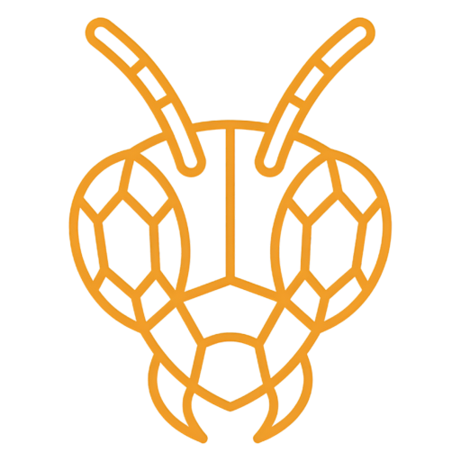
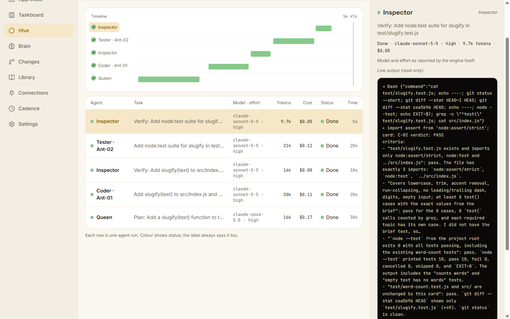

<p align="center">
  
</p>

<h1 align="center">The Insectoids</h1>

<p align="center">
  <strong>A local-first AI operating system, organised like a hive.</strong><br>
  You give the Queen a goal. Insect agents do the work in safe copies of your project.<br>
  An Inspector checks it. Nothing reaches your files without your approval, and everything can be undone.
</p>

<p align="center">
  <a href="https://github.com/Sanit-mann/The-Insectoids/releases/tag/v0.0.1">v0.0.1 · developer preview</a> ·
  <a href="LICENSE">MIT license</a> ·
  <a href="CONTRIBUTING.md">Contributing</a> ·
  <a href="functions/README.md">Design specs</a>
</p>

---


## What it is

The Insectoids is a desktop app that turns AI coding agents into an organised team you can trust with a real project.

- **The Queen** turns your goal into a plan of small task cards, grouped in waves. You approve the plan.
- **Insects** (Coder, Tester, and more castes later) pick up cards for their caste. Each one works in **its own git worktree**, a separate copy of your project, so they can work in parallel without touching your files.
- **The Inspector** checks every card against its "done means" list, with evidence such as tests run and diffs read, before the hive accepts it.
- **You approve the merge** into your branch. Undo is one click (with approval) and keeps the history; you can merge again later.
- **The Brain** is one local memory that every agent shares: decisions, tasks, facts and outcomes, with trust levels and version history. It lives in a SQLite file on your computer and is never uploaded.

It runs on the AI subscription you already have. Phase 1 uses **Claude Code** as its engine; more engines come in Phase 2.

## Status: v0.0.1 (Phase 1 "First Spark")

This is an early developer preview, built and tested on Windows. There is no installer yet: you run it from source (see [Run it](#run-it)).

**What works today:**

- The full loop: goal → plan approval → parallel insects in worktrees → Inspector verification → merge approval → undo → merge again.
- Six live screens: Queen chat, Approval inbox, Taskboard, Hive monitor (live agent output), Changes & undo (diffs), and a Brain reader.
- A first-run setup wizard: Brain folder, Claude Code check, a short "about you", safety presets (Careful / Balanced / Hands-off).
- The Brain service with two doors for agents: an **MCP server** and a **`brain` command-line tool**.
- A command guard in front of every agent action (details under [Safety](#safety)).

**Real end-to-end demo** (Claude Code, sample project `tiny-text`, goal "add `slugify(text)` with tests and docs"):

| | Run 1 | Run 2 |
|---|---|---|
| Result | Passed | Passed |
| Time, goal to merged | 1.8 min | 1.6 min |
| Tokens / cost reported by Claude Code | 83k / $0.53 | 82k / $0.51 |
| Cards, retries | 2 cards, 0 retries | 2 cards, 0 retries |
| Project tests on `main` after merge and after redo | 10/10 pass | 10/10 pass |

Run 1 found a real gap (insects committing by themselves); it was fixed and confirmed in run 2. The full write-up is in [docs/plans/phase-1-first-spark.md](docs/plans/phase-1-first-spark.md).

**Tests:** 434 unit tests and 36 end-to-end tests (Playwright driving the real Electron app). A scripted engine runs the whole flow without spending tokens.

## What makes it different

Many projects run several AI agents. The Insectoids focuses on making their work **safe, checkable and reversible** on a real project.

| | The Insectoids |
|---|---|
| **Your files are never edited directly** | Every card runs in its own git worktree and branch. Only the hive commits, with the agent and card named on every commit. Your branch changes only when you approve a merge. |
| **Work is verified, not just reported** | A separate Inspector agent checks every card against its acceptance criteria. "Done" means it passed, not that an agent said so. |
| **Everything is undoable** | Undo a card, a whole goal, or the merge into your branch. History is kept, so you can merge again. |
| **A guard in front of every action** | Deleting outside the workspace, force-pushing, reading secrets, touching system settings: blocked, always. Pushing, publishing and new dependencies wait for your approval. |
| **One shared memory, built to save tokens** | Agents read a short boot card first, then search and read within a token budget, instead of re-reading everything each time. |
| **Memory you can trust** | Facts an agent writes start as *unconfirmed*; only you can confirm them. Nothing is deleted: changes become versions. Secrets are refused. |
| **Tool-agnostic doors** | Any MCP-capable AI tool can use the Brain; tools without MCP use the `brain` command. |
| **Local-first and private** | The Brain stays on your computer. No account, no telemetry, nothing uploaded. Agents never see your keys. |
| **You stay in charge** | One inbox for every decision, with "why it needs you" and "if you say yes" in plain words. Destructive approvals need a press-and-hold. |
| **Honest numbers** | The UI shows the model that actually ran and the effort the hive asked for, with real token counts and cost as reported by the engine. |

Compared with the projects that inspired it (credited below), it adds strict workspace isolation, independent verification, approvals and undo around the agents, and keeps it all in one desktop app with a shared, local memory.

## How it works

```
 You ──goal──▶ Queen ──plan (waves of cards)──▶ Approval inbox ──▶ Taskboard
                                                                       │
              ┌─────────────── insects pull cards for their caste ◀────┘
              ▼
   Coder / Tester ── each in its own git worktree, behind the command guard
              │
              ▼
          Inspector ── checks "done means" with evidence ──▶ hive branch
                                                                │
 You ◀── "Merge into main?" ◀───────────────────────────────────┘
          approve ─▶ merged   ·   undo ─▶ reverted   ·   merge again ─▶ re-applied

 The Brain (one local SQLite file, one writer) records every decision, task and outcome.
 Agents reach it through MCP or the `brain` command, with a token scoped to their project.
```



## Run it

You need **Node.js 24+**, **git**, and **Claude Code** (signed in) for real runs. pnpm is pinned in `package.json` and provided by Corepack:

```bash
corepack enable pnpm
```

On Windows, if that fails with `EPERM` (Node is installed in `C:\Program Files`, which needs admin rights), put the `pnpm` command in your user npm folder instead. Run this in PowerShell:

```powershell
corepack enable pnpm --install-directory "$env:APPDATA\npm"
```

Then:

```bash
pnpm install
```

```bash
pnpm dev
```

The setup wizard opens on first run. Pick a small git project folder, then give the Queen a goal.

**Checks** (`pnpm check` runs lint, typecheck and unit tests; `pnpm test:e2e` builds the app and drives it with Playwright):

```bash
pnpm check
```

```bash
pnpm test:e2e
```

**The Phase 1 demo**, without tokens (scripted engine) or with real Claude Code. Real runs use your subscription; the two runs above cost about $0.50 each. Run either from `apps/desktop`; results go to `demo-runs/`:

```bash
INSECTOIDS_DEMO=fake pnpm exec playwright test e2e/phase1-demo.spec.ts
```

```bash
INSECTOIDS_DEMO=real pnpm exec playwright test e2e/phase1-demo.spec.ts
```

## Where things are

| Folder | What's in it |
|---|---|
| [`functions/`](functions/README.md) | The design: one spec per function (Memory, Hive, Capabilities, Connections, Cadence, Workspace & Safety, App, Onboarding, Tech Stack, Roadmap) |
| [`docs/plans/`](docs/plans/) | Build plans with progress notes and findings |
| [`apps/desktop/`](apps/desktop/) | The Electron app: main process, Brain host (utility process), preload bridge, React UI, e2e tests |
| [`packages/brain`](packages/brain/) | The Brain: records, versions, trust, secrets guard, full-text search, taskboard, goals, approvals |
| [`packages/brain-service`](packages/brain-service/) | The single-writer Brain service and its client |
| [`packages/brain-mcp`](packages/brain-mcp/) · [`packages/brain-cli`](packages/brain-cli/) | The Brain's doors for agents: MCP server and `brain` command |
| [`packages/harness`](packages/harness/) | The hive runtime (Queen, Foreman, insects, Inspector, Treasurer router) and the Claude Code adapter |
| [`packages/workspace`](packages/workspace/) | Git worktrees per card, the single committer, merge, undo |
| [`packages/reflexes`](packages/reflexes/) | The command guard and the Claude Code pre-action hook |
| [`packages/shared`](packages/shared/) | Types, schemas and the typed IPC contracts |
| [`library/`](library/) | Agents, skills and tools the hive uses, plus a dormant catalog |
| [`design/`](design/) | UI prototype, brand and screenshots |

## Roadmap

- **Phase 1 "First Spark" (done, v0.0.1):** the safe end-to-end loop with one engine.
- **Phase 2 "The Full Hive":** all 8 castes and the manager agents, more engines (Codex, Gemini CLI, OpenCode with OpenRouter, Ollama, LM Studio), a cost-aware router, the Vault and secret broker, meaning search and a graph view for the Brain.
- **Phase 3 "Cadence & Polish":** schedules and triggers, a "while you were away" digest, installers and auto-update.
- **Phase 4 "Expansion":** more connections, a container sandbox mode, more Brain views.

Details: [functions/10-build-roadmap.md](functions/10-build-roadmap.md).

## Help build it

The Insectoids is open source and early, and there's a lot of interesting work left. If you care about AI agents that are safe, verifiable and actually useful on real projects, please join in. Good places to start:

- **Try it** on a small project and open an issue with what worked and what didn't.
- **Test on macOS and Linux.** It's built and tested on Windows; CI runs all three, but real use there is new.
- **Break the guard.** Find a command that slips past the safety rules (report it privately, see [SECURITY.md](SECURITY.md)).
- **Add an engine:** Codex, Gemini CLI or OpenCode adapters (Phase 2).
- **Improve the Brain:** meaning search (embeddings in the same SQLite file), ranking, the graph view.
- **Sharpen the library:** better agent and skill instructions, measured by real runs.
- **UI and accessibility:** keyboard flows, screen readers, the living-hive view.

Read [CONTRIBUTING.md](CONTRIBUTING.md) to get set up. Ideas and questions are welcome in issues.

## Credits

The Insectoids stands on the shoulders of these projects. Thank you to their authors.

**Studied for the design** (ideas, not code):

- [ruvnet/ruflo](https://github.com/ruvnet/ruflo): agent swarms, a queen-led hive, shared memory and managers.
- [nateherkai/AIS-OS](https://github.com/nateherkai/AIS-OS): a personal AI operating system and its "brain": route-don't-copy notes, confirmed facts kept apart from raw notes, decision logs, onboarding interview.
- [HarnessMD/munder-difflin](https://github.com/HarnessMD/munder-difflin): many AI CLIs as real terminal agents, engine setup and sign-in, a live view of every agent.
- [AgriciDaniel/claude-obsidian](https://github.com/AgriciDaniel/claude-obsidian): knowledge as a navigable graph.
- [ruvnet/ruvector](https://github.com/ruvnet/ruvector): ideas for Phase 2 memory ranking (importance and freshness scores, rank fusion).

**Adapted into the agent and skill library** (rewritten and merged; licenses in [library/licenses/](library/licenses/), details in [library/THIRD-PARTY-NOTICES.md](library/THIRD-PARTY-NOTICES.md)):

- [affaan-m/ecc](https://github.com/affaan-m/ecc) (MIT)
- [msitarzewski/agency-agents](https://github.com/msitarzewski/agency-agents) (MIT)
- [obra/superpowers](https://github.com/obra/superpowers) (MIT)
- [ruvnet/ruflo](https://github.com/ruvnet/ruflo) (MIT)
- [multica-ai/andrej-karpathy-skills](https://github.com/multica-ai/andrej-karpathy-skills) (MIT)
- [vercel-labs/agent-skills](https://github.com/vercel-labs/agent-skills) (MIT)
- [juliusbrussee/caveman](https://github.com/juliusbrussee/caveman) (Apache-2.0)
- [vercel-labs/agent-browser](https://github.com/vercel-labs/agent-browser) (Apache-2.0)
- [microsoft/playwright-mcp](https://github.com/microsoft/playwright-mcp) (Apache-2.0)

**UI components** (adapted; source noted at the top of each file): [Kokonut UI](https://kokonutui.com), [Cult UI](https://cult-ui.com) and [shadcn/ui](https://ui.shadcn.com). Icons by [Lucide](https://lucide.dev).

**Built with:**
- Electron, React, Tailwind CSS, electron-vite and Vite;
- Node's built-in `node:sqlite` with FTS5;
- the [Model Context Protocol SDK](https://github.com/modelcontextprotocol/typescript-sdk), zod, Motion and Radix;
- pnpm, Vitest and Playwright;
- fonts: Inter, Space Grotesk and JetBrains Mono (SIL Open Font License).

The engine is [Claude Code](https://www.anthropic.com/claude-code) by Anthropic. The Insectoids is an independent project, not affiliated with or endorsed by Anthropic or any project listed here.

## Safety

The command guard is one strong layer, not a sandbox: it parses every shell command and file action before it runs.
- **Always blocked:** deleting outside the workspace, force-pushing, reaching outside the repo, links that escape the workspace, disk and system changes, piping downloads into a shell, privilege escalation, protected files (`.env`, SSH and cloud keys, browser profiles), and git commands that commit or move branches (only the hive commits).
- **Needs your approval:** pushing, publishing and deploying, new dependencies, destructive database commands.

It fails closed: if the guard can't run, the action is blocked. A container sandbox mode for untrusted code is planned for Phase 4.

## Privacy

The Brain stays on your computer and nothing is uploaded. There is no telemetry and no account. Agents never see your API keys or logins. Fonts are bundled, so the app makes no hidden network calls. The only network traffic is what your AI engine (Claude Code) itself does.

## License

[MIT](LICENSE). Parts of `library/` are adapted from MIT and Apache-2.0 projects; see [library/THIRD-PARTY-NOTICES.md](library/THIRD-PARTY-NOTICES.md).
